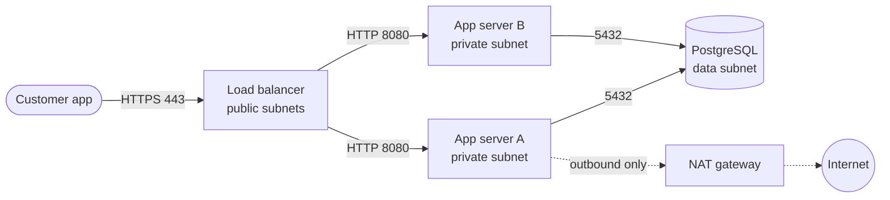
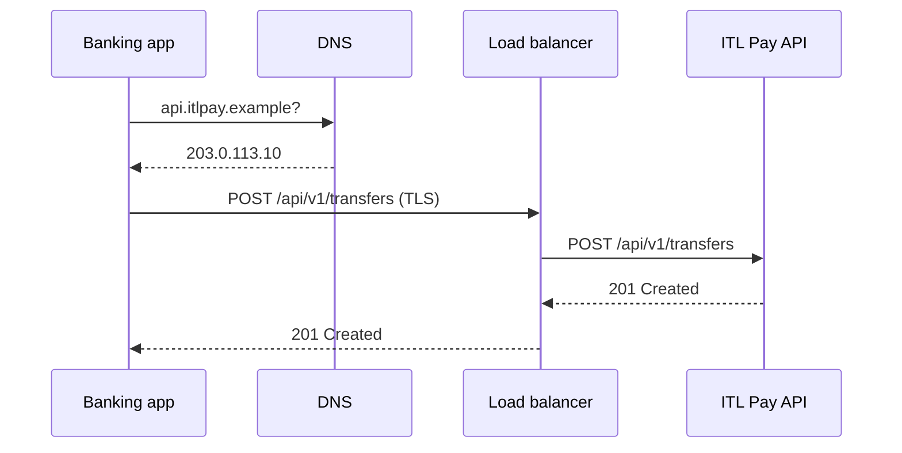

## What you will be able to do

- Write in Markdown: headings, lists, tables, links, code blocks.
- Write a README that lets a stranger understand, run and trust your project in five minutes.
- Write a **runbook**: step-by-step instructions someone can follow during an incident, half-asleep.
- Draw architecture and flow diagrams as code with **Mermaid**, so they live in Git and render on GitHub.
- Record important decisions in short **Architecture Decision Records (ADRs)**.
- Keep documentation next to the code, reviewed in pull requests, so it stays true.

## Why this matters at work

When production breaks at night, the on-call engineer opens the runbook, not the code. When a new engineer joins, the README and the diagrams are how they learn the system. When an auditor asks why the database isn't in Lagos, the decision record answers. Teams that keep documentation in Git, next to the code and reviewed like code, have documentation that's still correct a year later; teams that keep it in someone's head or a forgotten wiki don't. In remote jobs especially, clear writing is how you're judged: your teammates may be in Berlin and Toronto, and they read your work long before they hear your voice.

## 1. Markdown in ten minutes

Markdown is plain text with light formatting. GitHub, GitLab, Azure DevOps and most documentation tools render it.

````markdown
# Heading 1
## Heading 2

Plain paragraph with **bold**, *italic* and `inline code`.

- A bullet
- Another bullet
  - Indented

1. Numbered step
2. Next step

[A link](https://itlearning.tech) and an image: 

| Port | Service |
| --- | --- |
| 22 | SSH |
| 443 | HTTPS |

```bash
sudo systemctl restart itlpay
```

> **Warning:** this deletes data.
````

Tips: leave a blank line between blocks; give code blocks a language (`bash`, `python`, `yaml`) so they're highlighted; preview with **Ctrl+Shift+V** in VS Code or on GitHub's **Preview** tab.

## 2. A README that works

The README is the front door of a repository. A stranger (a reviewer, a new teammate, a hiring manager) should be able to answer three questions in five minutes: **what is this, how do I run it, and can I trust it?**

````markdown
# ops-scripts


Small, tested scripts for running Linux servers: a daily health report,
backup checks and a URL monitor.

## What's here

| Script | What it does |
| --- | --- |
| `health-report.sh` | Disk, memory and failed services; exits 1 if anything needs attention |
| `check_backups.py` | Alerts if the newest backup is more than 26 hours old |
| `checker.py` | Checks a list of URLs and writes a JSON report |

## Quick start

```bash
git clone git@github.com:ada-obi/ops-scripts.git && cd ops-scripts
python3 -m venv .venv && .venv/bin/pip install -r requirements.txt
./health-report.sh 80
```

## Tests

`pytest -q` and `shellcheck *.sh`; both run on every pull request.

## Requirements

Ubuntu 22.04 or later, Python 3.12, bash 5.
````

Good READMEs are **short, current and runnable**: every command in them has been run. Put long material (design notes, runbooks) in a `docs/` folder and link to it.

## 3. Runbooks

A **runbook** is a step-by-step procedure for one known situation: an alert firing, a routine task, a recovery. It's written for someone who is tired, stressed and may not know the system well.

````markdown
# Runbook: ITL Pay API returns 503

**Alert:** `itlpay-api-503-rate` (more than 5% of requests return 503 for 5 minutes)
**Impact:** customers can't make transfers.
**Owner:** Platform team · **Last tested:** 2026-11-02

## 1. Check the load balancer's targets
- AWS: EC2 → Target groups → `itlpay-api` → Targets tab
- Azure: Application Gateway → `itlpay-agw` → Backend health

If **all targets are unhealthy**, go to step 2. If **some** are, go to step 3.

## 2. All targets unhealthy
1. SSH (or Session Manager / Azure Bastion) to one app server.
2. `systemctl status itlpay` and `journalctl -u itlpay --since "15 min ago"`.
3. If the service has stopped: `sudo systemctl restart itlpay`, then
   `curl -s localhost:8080/health` should return `{"status":"UP"}`.
4. If it returns `{"status":"DOWN","db":"unreachable"}`, follow
   [Database unreachable](database-unreachable.md).

## 3. Some targets unhealthy
...

## Escalate
If not resolved in 20 minutes, page the secondary on-call and post in #incidents.
````

What makes it good:

- It starts from the **alert** someone actually sees, and says what the impact is.
- Every step is a **command or a click**, with what you should see if it worked.
- It **branches** on what you find, instead of telling a story.
- It says **when to escalate**, and to whom.
- It shows **when it was last tested**. A runbook nobody has followed in a year is probably wrong. Teams test runbooks during practice incidents ("game days", which you'll run in Phase 3).

Runbooks are the first step to automation: once a runbook's steps are always the same, they become a script, and the runbook shrinks to "run this".

## 4. Diagrams as code with Mermaid

Diagrams drawn in a drawing tool and pasted as images go out of date, because nobody can easily change them. **Mermaid** describes a diagram as text inside Markdown; GitHub draws it.

````markdown

````

Sequence diagrams show who talks to whom, in order, which is useful for explaining a request or an incident:

````markdown

````

Because the diagram is text, changes to it show up in pull requests like any other change, and reviewers can say "this arrow is wrong". For more detailed cloud diagrams with the official AWS and Azure icons, teams also use **draw.io** (diagrams.net), whose files can be saved in the repository too; you'll use it for Capstone 1.

## 5. Architecture Decision Records

An **ADR** records one important decision: what was decided, why, and what else was considered. It's short (one page), numbered, and never deleted: if a decision changes, a new ADR replaces the old one and says so.

```markdown
# ADR 003: Run the production database in the Cape Town region

**Status:** Accepted · **Date:** 2026-11-06 · **Deciders:** Platform team, Compliance

## Context
ITL Pay stores Nigerian customers' personal data. The Nigeria Data Protection Act
requires adequate protection for data sent abroad. Latency from Lagos to Europe is
about 100 ms; to South Africa about 60–80 ms.

## Decision
Run production in AWS af-south-1 (Cape Town), with backups copied to a second region.

## Options considered
1. af-south-1 (Cape Town): chosen. Closest AWS region; meets the data-protection review.
2. eu-west-1 (Ireland): more services and lower prices, but higher latency and a
   longer data-protection review.
3. Azure South Africa North: equally suitable; rejected because the team's
   existing tooling is on AWS. Revisit in 12 months.

## Consequences
- Some newer AWS services arrive later in af-south-1; check availability before using them.
- Costs are about 10–15% higher than eu-west-1 (estimate in docs/costs.md).
```

Keep ADRs in `docs/adr/` with numbered file names (`0003-production-region.md`). Your capstones in this course each need at least two.

## 6. Keeping documentation true

- **Docs live with the code** in the same repository, and change in the **same pull request** as the code they describe. Reviewers should ask "does the README still match?"
- **Run what you write.** Every command in a README or runbook should have been run. Better still, make the commands into scripts that CI tests.
- **Date and own** runbooks: a "last tested" date and an owner.
- **Delete** what's wrong. Out-of-date documentation is worse than none, because people trust it.
- **Write for the reader** who's stressed and new: short sentences, one action per step, no unexplained abbreviations.

## Practice

1. Rewrite your `ops-scripts` README using section 2 as a model. Ask someone (in the forum, or a friend) to follow the quick start from a fresh clone; fix whatever they get stuck on.
2. Write a runbook for "a server's disk is almost full", using your Module 1 and 3 knowledge. Include commands, expected output, branches, and when to escalate. Test it on a VM where you've filled a disk with `fallocate -l 2G /tmp/bigfile`.
3. Draw ITL Pay's network from topic 2.5 as a Mermaid flowchart in `docs/architecture.md`, and check it renders on GitHub.
4. Draw the request journey from topic 2.1 (DNS, TCP, TLS, load balancer, app) as a Mermaid sequence diagram.
5. Write an ADR: "Use systemd timers instead of cron for scheduled jobs on our servers" (topic 3.3), with at least two options considered.

## Watch

English videos with English captions, checked on 2026-11-06. On itlearning.tech they play inside the lesson.

- [The Only Markdown Crash Course You Will Ever Need](https://www.youtube.com/watch?v=_PPWWRV6gbA) · Web Dev Simplified · 22 min. Markdown, everything you need for READMEs and runbooks.
- [Mermaid In Markdown, Diagrams As Code: Introduction, How-to, And Demo](https://www.youtube.com/watch?v=qGsQolMh9zE) · PetterTech · 11 min. Diagrams as code with Mermaid in Markdown.

## Further learning (free)

Free, self-paced courses from the two clouds that go with this topic. They're optional: use them to go deeper or to prepare for the certification exams. Sign in with a free Microsoft account for Microsoft Learn and a free AWS Builder ID for AWS Skill Builder to track your progress.

**Azure (Microsoft Learn):**

- [Communicate effectively on GitHub using Markdown](https://learn.microsoft.com/training/modules/communicate-using-markdown/)
- [Upload your project by using GitHub best practices](https://learn.microsoft.com/training/modules/upload-project-github/)

