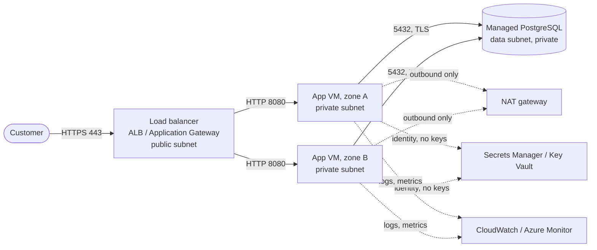

# Capstone 1: ITL Pay on AWS and Azure, by hand then by script

**Week 13 · Phase 1: Cloud Foundations** · About 20–25 hours · Individual work

You'll deploy ITL Pay Lite, a small payments API, on **both** AWS and Azure. You'll build it the way a junior cloud engineer would at a bank: a private three-tier network, no open SSH, the database password in a vault, HTTPS, alerts, and a runbook. Then you'll rebuild it from one script and compare the two clouds.

This capstone is what you'll show employers from Phase 1. Treat the repository as your portfolio.

## What you build, on each cloud

| Requirement | AWS | Azure | Topic |
| --- | --- | --- | --- |
| A network from your address plan, public / app / data tiers, two zones, no overlap between the clouds | VPC, subnets, IGW, NAT, route tables | VNet, subnets, NAT gateway, NSGs + ASGs | 2.2, 2.5, 6.4 |
| Security rules that allow only: 443 to the load balancer, 8080 from the load balancer to the app, 5432 from the app to the database | Security groups referencing each other | NSGs, ASGs, explicit deny inside the VNet for the data tier | 2.5, 6.4 |
| Two app VMs in different zones, **no public IPs, no inbound SSH**, configured only by cloud-init, running ITL Pay Lite from your registry image | EC2 + Session Manager, IMDSv2 | VMs + Bastion (or run-command), managed identity | 5.4, 6.5 |
| A private managed PostgreSQL, encrypted, TLS required, 7-day backups | RDS | Flexible Server (private access) | 6.7 |
| The database password only in a vault, read by the VMs' identities | Secrets Manager | Key Vault (RBAC) | 6.2, 6.7 |
| A load balancer with a health check on `/health`, HTTPS with a valid certificate on at least one cloud, HTTP redirected to HTTPS | ALB + ACM + Route 53 alias | Application Gateway + Key Vault certificate + Azure DNS alias | 2.4, 6.8 |
| Logs in the cloud, a dashboard, and at least two alerts by email (healthy hosts, and one database alert) | CloudWatch Logs, alarms, SNS | Log Analytics, alert rules, action group | 6.9 |
| Budgets and tags on everything (`owner`, `purpose=capstone-1`) | Budgets | Cost Management budget | 6.1 |

You may run both clouds' environments at different times to save credit; you don't need them running together.

## Two ways to build it

1. **By hand first**, in the consoles and CLIs, following Module 6. Take notes as you go.
2. **Then by script:** `deploy-aws.sh` and `deploy-azure.sh` that build the whole environment from nothing, and `destroy-aws.sh` / `destroy-azure.sh` that remove it. The scripts must:
   - use strict mode, pass `shellcheck`, check which account/subscription they're in, and ask before changing anything (topics 3.2, 6.3);
   - be safe to run twice (check before create);
   - tag every resource;
   - never print or store secrets.

Prove the scripts work: destroy everything, run the deploy script, and show the health check and a transfer succeed. (In Phase 2 you'll replace these scripts with Terraform, and you'll appreciate why.)

## What to submit

A **public GitHub repository** (or private and shared with the mentors) containing:

| Path | What |
| --- | --- |
| `README.md` | What it is, a diagram, how to deploy and destroy, how to test, cost estimate, status badge |
| `docs/architecture-aws.md`, `docs/architecture-azure.md` | Mermaid diagrams (network, security rules, request flow) |
| `docs/address-plan.md` | Both address plans, with the overlap check |
| `docs/adr/0001-region-choice.md`, `docs/adr/0002-...md` | At least two decision records (for example region; how admins get access; where TLS ends) |
| `docs/runbooks/api-503.md`, `docs/runbooks/restore-database.md` | Runbooks for both clouds, tested, with "last tested" dates |
| `docs/comparison.md` | One page: AWS vs Azure for this system. What was easier, what cost more (with your pricing-calculator estimates), what surprised you, and **which cloud you'd recommend for a Nigerian bank, and why** |
| `docs/evidence/` | Screenshots or command output proving each requirement (see the checklist below) |
| `cloud-init.yaml`, `scripts/deploy-*.sh`, `scripts/destroy-*.sh`, `scripts/itlpay-start.sh` | The automation |
| `.github/workflows/checks.yml` | `shellcheck` on every script (topic 4.2) |

### Evidence checklist

For **each** cloud:

- [ ] `curl https://<your-name>/health` returns `{"status":"UP","db":"up"}` (HTTP on one cloud if you have no domain; say so)
- [ ] A transfer succeeds, and balances still add up
- [ ] The app VMs have no public IP, and an internet-to-VM check (Reachability Analyzer / IP flow verify) fails
- [ ] The database isn't reachable from the public tier, and is from the app tier
- [ ] Admin access works through Session Manager / Bastion with no inbound SSH rule
- [ ] `aws sts get-caller-identity` / `az login --identity` from a VM shows its role / managed identity
- [ ] With one app VM stopped, the service keeps working; with both stopped, the alert fires by email
- [ ] A point-in-time restore of the database was done and timed (on at least one cloud)
- [ ] The budget alerts exist, and every resource has the tags
- [ ] After `destroy-*.sh`, nothing billable is left (screenshot of an empty resource list by tag)

## How it's graded

Submit the repository link in **Capstone 1 submission** on itlearning.tech. The mentor or administrator grades it with this rubric. Each criterion is scored 0–4; **the pass mark is 14 of 20, with no criterion at 0**.

| Criterion | 0: Missing | 1: Beginning | 2: Developing | 3: Competent | 4: Strong |
| --- | --- | --- | --- | --- | --- |
| **1. It works, on both clouds** | Not deployed | Deployed on one cloud only, or not working end to end | Works on both, with gaps (no HTTPS anywhere, one zone only) | Works on both: two zones, HTTPS on at least one, health checks, transfers succeed | As 3, plus HTTPS on both, failover demonstrated and timed |
| **2. Security** | Public database, open SSH, or secrets in Git | Several exposures (public VMs, keys on VMs, wide security rules) | Mostly private; one significant gap | Private tiers, no inbound SSH, identities instead of keys, password in a vault, TLS to the database, narrow rules | As 3, plus evidence for every rule (reachability checks, flow logs) and IMDSv2 / Entra login |
| **3. Automation** | No scripts | Partial scripts; manual steps needed | Scripts deploy most of it; not re-runnable or not shellcheck-clean | Deploy and destroy scripts for both clouds; strict mode, shellcheck-clean, idempotent, context checks, tags | As 3, plus proven by a full destroy and redeploy recorded in the evidence |
| **4. Operability** | No monitoring or runbooks | Logs only | Some alerts or a dashboard; runbooks untested | Logs centralised, dashboard, two tested alerts per cloud, two tested runbooks, a timed database restore | As 3, plus alert descriptions linking runbooks, and RTO/RPO written down |
| **5. Communication and cost** | No README or docs | README only | README and diagrams; comparison thin | Clear README, diagrams, address plans, two ADRs, a reasoned comparison with cost estimates | As 3, written so a hiring manager understands it in five minutes, with a cost table per cloud |

## The two certificate routes

- **Self-Study (free):** submit the repository, then record a **15–20 minute defence** and link it from your README (a GitHub release is best): a demo on both clouds, the network and security design, your scripts, a walk-through of one incident from your runbook, and your recommendation from the comparison. Then send the administrator a message on itlearning.tech asking for your check. The administrator quick-checks it within **15 working days**.
- **Mentor-Verified (mentorship):** a live defence with a mentor, including a live "break and fix": the mentor breaks one thing in your environment (a rule, a probe, a secret permission) and you diagnose and fix it with the method from topic 2.6.

## Keep the bill near zero

Build one cloud at a time, in focused sessions. The expensive items are the **load balancers** (especially Application Gateway), **NAT gateways** and the **databases**; destroy them when you stop for the day, and redeploy with your script. Check both bills the next day. If your credit is running low, tell your mentor before you start: the evidence can be gathered in two or three short sessions per cloud.

## Before you start

Re-read the topic 6.1 guardrails, check your budgets exist, and make sure you can sign in to both clouds as your everyday user (not root or Global Administrator).
