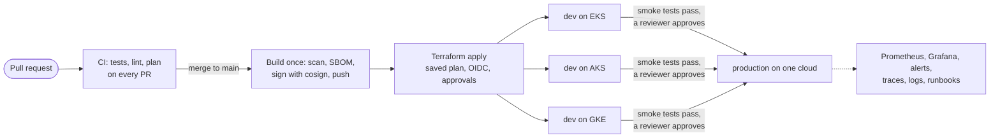

# Capstone 2: Pipeline to production across three clouds

**Weeks 24–25 · Phase 2: DevOps and Infrastructure as Code** · About 40–50 hours · Individual work

In Capstone 1 you built ITL Pay by hand, then with Bash. Now you'll build the platform a DevOps team would run it on, and **nobody touches production by hand**. A merged pull request goes through tests, a scanned and signed image, and Terraform. Then it reaches Kubernetes **dev environments on AWS, Azure and Google Cloud**, and, after a human approval, **production on one cloud**, with metrics, alerts, traces and runbooks, and no long-lived secret anywhere.

This is the capstone employers will ask about: "walk me through your pipeline" is the most common DevOps interview question, and you'll answer it with your own repository.

## What you build

| Requirement | Topics |
| --- | --- |
| **Infrastructure as code** for each cloud: the network (Module 7's modules), a managed Kubernetes cluster (EKS, AKS, GKE), the managed PostgreSQL database, the secret holding its credentials, and the identities, in Terraform with remote state, locking, and one root module per environment | 7.1–7.5, 9.5, 10.2 |
| **One pipeline** in GitHub Actions: tests and lint on every pull request, a Terraform plan posted on the pull request, and on `main`: build once, scan (fail on fixable HIGH/CRITICAL), SBOM, sign, then deploy the **same digest** everywhere | 8.1, 8.2, 8.4 |
| **No long-lived cloud keys**: OIDC from GitHub to all three clouds, with read-only plan identities and environment-only apply identities; pod identity for External Secrets | 8.3, 9.5, 10.2 |
| **Kubernetes deployment** with the Helm chart from topic 9.4 (or your own): probes, requests and limits, PodDisruptionBudget, autoscaling, restricted Pod Security, a NetworkPolicy, traffic through the cloud's Gateway API implementation | 9.1–9.5 |
| **Signed images only**: the deploy job runs `cosign verify` on the digest before deploying, and refuses an unsigned image | 8.2 |
| **Secrets** from AWS Secrets Manager, Azure Key Vault and Google Secret Manager through External Secrets; nothing secret in Git, in values files or in logs | 10.2 |
| **Environments**: `dev-aws`, `dev-azure`, `dev-gcp` deploy automatically; `prod-<your cloud>` needs a reviewer and runs only after the dev smoke tests pass | 8.4 |
| **A failed deployment rolls back by itself** (`helm upgrade --rollback-on-failure --wait`, then `helm test`), and you can show it | 9.4 |
| **Observability**: Prometheus metrics scraped (kube-prometheus-stack, or the cloud's managed Prometheus), the ITL Pay dashboard, SLO burn-rate alerts with `promtool` tests in CI, JSON logs in the cloud's log service, traces through an OpenTelemetry Collector to a real back end | 11.1, 11.2 |
| **Drift detection** every night, opening an issue | 7.5, 8.4 |
| **Cost control**: tags or labels on everything, budgets with alerts, and a `destroy` path (a workflow or documented commands) that leaves nothing billable | 6.1, 9.5 |

**What "production" means here.** Run three dev environments and **one** production environment, on the cloud you'd recommend (you'll defend the choice). Clusters are the expensive part: use EKS Auto Mode, AKS (free tier) or GKE Autopilot, one small node pool, and destroy environments when you stop for the day. Your pipeline recreates them. You don't need all four running at the same time; the evidence can come from separate sessions.

## Start from the kit

`labs/capstone-2-starter/` has working pipeline plumbing to copy into your repository:

| File | What it does |
| --- | --- |
| `.github/workflows/deliver.yml` | On `main`: CI, then build-scan-SBOM-sign once, then deploy that digest to the three dev environments, then to production after approval |
| `.github/workflows/deploy.yml` | Reusable: keyless login to one cloud, cluster credentials, `cosign verify`, `helm upgrade --rollback-on-failure`, `helm test` |
| `.github/workflows/ci.yml` | Tests (from topic 8.1) |
| `docs/evidence-checklist.md` | The checklist below, to fill in |

Bring your Terraform from Module 7 (plus the cluster, database and secret), `terraform.yml` from topic 8.4, the chart from `labs/kubernetes/`, the stores from `labs/secrets/` and the monitoring from `labs/observability/`. The kit is plumbing, not the answer: the infrastructure, the security design and the operations are yours.

## What to submit

A **public GitHub repository** (or private and shared with the mentors):

| Path | What |
| --- | --- |
| `README.md` | What it is, the diagram, how a change reaches production, how to create and destroy everything, status badges, cost |
| `infra/` | Terraform modules and one root module per environment and cloud, with remote state |
| `.github/workflows/` | CI, Terraform (plan on PR, apply with approvals, nightly drift), image, deploy |
| `deploy/` | The Helm chart (or a reference to it) and the values per environment and cloud; SecretStores and ExternalSecrets |
| `observability/` | Alert rules with `promtool` tests, dashboards as code, Collector configuration |
| `docs/architecture.md` | Diagrams per cloud: network, cluster, traffic, identities, secrets |
| `docs/adr/` | At least three decision records: which cloud for production and why; how secrets reach pods; one of your own (for example Gateway API vs Ingress, managed vs self-run Prometheus) |
| `docs/slo.md` | Your SLIs and SLOs, the error budget, and which alerts page whom |
| `docs/runbooks/` | At least three, linked from the alerts: error budget burn, a failed deployment, a database restore. Each with "last tested" |
| `docs/comparison.md` | EKS vs AKS vs GKE for this system: setup effort, networking, identity, cost per day from your bills, upgrade policy, what you'd choose and why |
| `docs/evidence/` | Proof for each item in the checklist |

### Evidence checklist

- [ ] A pull request shows: tests passing, a Terraform plan comment per cloud, and the image built and scanned (not pushed)
- [ ] After merge, one pipeline run deploys **one image digest** to `dev-aws`, `dev-azure` and `dev-gcp`, then waits for approval, then deploys it to production (screenshot of the run graph)
- [ ] `curl https://<prod host>/health` returns `{"status": "UP", "db": "up", ...}`; a transfer succeeds on production and on each dev environment
- [ ] `cosign verify` succeeds for the deployed digest; a deliberately unsigned image is **refused** by the deploy job
- [ ] No cloud access keys exist for the pipeline or the pods (console screenshots), and the trust policies name your repository and environments
- [ ] `kubectl get externalsecret -n itlpay` shows `SecretSynced` on each cluster; the chart's values contain no secret
- [ ] A broken release (for example a bad image tag or a failing readiness probe) **rolls back by itself**, and production keeps serving during it (a `curl` loop's output)
- [ ] Prometheus shows the ITL Pay targets up; the dashboard shows real traffic; a burn-rate alert fires (stop the database in dev) and resolves, with its runbook link
- [ ] A trace of one transfer in the cloud's tracing service (or Tempo/Jaeger), and its log line found by `trace_id`
- [ ] The nightly drift job opened an issue after a manual change, and you resolved it (undo or adopt)
- [ ] One environment destroyed and recreated from the pipeline, timed (your recovery time)
- [ ] Budgets exist on all three clouds, every resource is tagged, and after teardown nothing billable is left

## How it's graded

Submit the repository link in **Capstone 2 submission** on itlearning.tech. The mentor or administrator grades it with this rubric. Each criterion is scored 0–4; **the pass mark is 14 of 20, with no criterion at 0**.

| Criterion | 0: Missing | 1: Beginning | 2: Developing | 3: Competent | 4: Strong |
| --- | --- | --- | --- | --- | --- |
| **1. Delivery pipeline** | No working pipeline | Builds and tests only; deploys by hand | Deploys automatically to some environments; no approvals, or different images per environment | One image digest from PR to dev on all three clouds and to production behind an approval, with smoke tests and automatic rollback | As 3, plus a demonstrated rollback during live traffic with no failed requests, and pipeline duration under 20 minutes |
| **2. Infrastructure as code** | Built by hand | Some Terraform; local state or manual steps | Terraform for most of it; remote state; gaps (no plan review, or no drift check) | All infrastructure in Terraform with remote state and locking, plans on PRs, saved-plan applies through environments, nightly drift detection | As 3, plus modules shared across clouds, policy checks (checkov/tflint) gating the plan, and a timed recreate of a whole environment |
| **3. Security and supply chain** | Long-lived keys or secrets in Git | Several exposures (wide permissions, unsigned images, secrets in values) | Mostly keyless; one significant gap | OIDC everywhere with separate plan/apply identities, pod identity for secrets, scanned and signed images verified before deploy, restricted Pod Security, a NetworkPolicy, no secrets in Git or logs | As 3, plus an admission policy that blocks unsigned images in the cluster (for example Kyverno or Sigstore policy-controller) and secret scanning with push protection |
| **4. Operability** | No monitoring | Logs only | Metrics and a dashboard; alerts untested or noisy | SLOs written down, burn-rate alerts tested with promtool and proven firing, dashboards as code, traces and logs linked by trace ID, three tested runbooks linked from alerts | As 3, plus a game day write-up (a failure injected, detected, diagnosed and fixed, with a timeline) |
| **5. Communication and cost** | No README or docs | README only | README and diagrams; comparison thin | Clear README and diagrams, three ADRs, a reasoned EKS/AKS/GKE comparison with real daily costs, a working teardown | As 3, written so a hiring manager understands it in five minutes, with a cost table per environment and a plan to cut it |

## The two certificate routes

- **Self-Study (free):** submit the repository, then record a **20–25 minute defence** and link it from your README: a change going from pull request to production, the architecture and security design, one runbook walked through, your SLOs and alerts, and your cloud recommendation. Then send the administrator a message on itlearning.tech asking for your check. The administrator quick-checks it within **15 working days**.
- **Mentor-Verified (mentorship):** a live defence with a mentor, including a live "break and fix": the mentor breaks one thing (a trust policy, a NetworkPolicy, an alert rule, a secret permission) and you find it from your dashboards and logs, fix it **through the pipeline**, and explain what would have caught it sooner.

## Keep the bill near zero

The expensive items are the **clusters and their nodes**, **load balancers** created by Gateways, **NAT gateways** and **databases**. Work one cloud at a time, destroy environments at the end of each session (your pipeline recreates them), delete Gateways and PVCs before clusters, and check all three bills the next day. If credit is short, talk to your mentor before starting: a reduced scope (two clouds in dev, kind for the third) can still pass if it's agreed in advance and documented in your README.

## Before you start

Check your budgets and alerts exist on all three clouds, your Module 7 Terraform still plans cleanly, and the OIDC trusts from topic 8.3 work for your capstone repository's name (new repositories use the immutable subject format).
