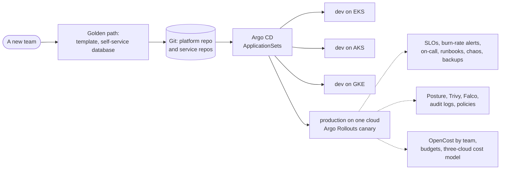

# Capstone 3: Run a three-cloud platform

**Weeks 34–35 · Phase 3: Platform Engineering and SRE** · About 50–60 hours · Individual work

In Capstone 2 you built a pipeline that ships ITL Pay to three clouds. Now you **run** it the way a platform and SRE team does: Git is the only way to change anything, releases roll out gradually and roll back on their own, reliability is measured against targets, failures are rehearsed, other teams serve themselves through a golden path with guardrails, security findings are fixed in code, and you can say what every team's services cost, and which cloud you'd choose for what.

This is the capstone for platform engineer and SRE roles: "how do you run production?", "how do you onboard a new team?" and "what happened in your last incident?" are the questions you'll answer with your own platform.

## What you build

Start from your Capstone 2 repository (or the course's reference platform if your mentor agrees): it already has the infrastructure, pipeline, chart, secrets and observability.

| Requirement | Topics |
| --- | --- |
| **GitOps everywhere**: Argo CD (installed by your pipeline or Terraform) syncs every environment from Git with an ApplicationSet; nobody runs `kubectl apply` or `helm upgrade` by hand. Drift is corrected automatically, and the pipeline's job ends at a commit that changes the image digest | 12.1 |
| **Progressive delivery** in production: an Argo Rollouts canary with steps, analysed by Prometheus (error rate and latency), that **aborts and rolls back by itself** when the analysis fails | 12.2 |
| **Environments and promotion**: Kustomize overlays or Helm values per environment; promotion from dev to production is a reviewed pull request | 12.3 |
| **SLOs and an error budget policy**: SLIs for availability and latency, SLOs, the budget, burn-rate alerts tested with `promtool`, and a written policy saying what happens when the budget runs out | 13.1 |
| **Incident response**: an on-call rota (even a rota of one), severity levels, and **one incident run end to end**: alert, response, timeline, and a blameless postmortem with actions | 13.2 |
| **Chaos and recovery**: at least two chaos experiments with a hypothesis and steady-state check (pod kill, network latency or database failure); Velero backups with a **timed restore**; your RTO and RPO, measured | 13.3, 13.4 |
| **A golden path**: a template (Backstage software template, or a Cookiecutter/`gh repo create --template` equivalent) that creates a new service with its pipeline, chart, Argo CD application, dashboards and alerts, and **a second service onboarded through it** | 14.1 |
| **Self-service infrastructure**: a team gets a database (or bucket, or queue) by committing a claim: a Crossplane composition or a Terraform module behind a pull request | 14.2 |
| **Guardrails as code**: Kyverno (or Gatekeeper) policies in every cluster (no `:latest`, requests and limits, team labels, signed images), Conftest on Terraform in CI, and the cloud's organisation policies for regions and public access | 14.3 |
| **Security posture**: the cloud's posture service on for production's account, the top findings fixed **in code** (before and after), Trivy configuration scans in CI, Falco alerting on runtime behaviour, and audit logs shipped to a separate account, subscription or project | 15.1, 15.2 |
| **Data residency**: a policy that fails the pipeline if anything is created outside your allowed regions, with tests | 15.2 |
| **Cost**: OpenCost (or the clouds' Kubernetes cost views) reporting cost per team label; budgets and anomaly alerts on all three clouds; **one optimisation implemented and measured** (rightsizing, scheduling dev to zero, spot for stateless replicas) | 16.1 |
| **The cloud decision**: `compare_costs.py` (or your own model) with **real prices** for your regions, and a recommendation for where ITL Pay's production should run, with the trade-offs | 16.2 |

Optional, counts towards "Strong": run the topic 17.1 triage assistant (read-only, redacted, human-approved) during your incident or game day and evaluate how good its first summary was.

**What "three clouds" means here.** Production runs on one cloud. The other two run **dev**, synced by the same Argo CD ApplicationSet from the same Git repository, proving the platform is portable. You don't need everything running at once: bring environments up for the evidence, record it, and tear them down (see "Keep the bill near zero").

## Start from the kit

`labs/capstone-3-starter/` has the documents to fill in and, from the course's labs, pointers to the pieces you'll reuse:

| File | What it is |
| --- | --- |
| `docs/evidence-checklist.md` | The checklist below, to fill in with links to your evidence |
| `docs/game-day.md` | A game day plan and write-up template |
| `docs/platform-handbook.md` | The outline of a handbook for teams using your platform |

The error budget policy (`labs/sre/slo/error-budget-policy.md`) and the postmortem template (`labs/sre/incident/postmortem-template.md`) from Module 13 are your starting points for those documents.

Reuse the course's labs: `labs/gitops/` (Argo CD, ApplicationSet, Rollouts with analysis), `labs/sre/` (SLO tool, chaos, Velero), `labs/platform/` (golden path, Crossplane, Kyverno, Conftest), `labs/security/` (Trivy, Falco, audit, residency), `labs/finops/` (OpenCost, cost model) and `labs/aiops/` (triage assistant). The kit is paperwork and pointers, not the answer: the platform and how you run it are yours.

## What to submit

A **public GitHub repository** (or private and shared with the mentors), plus the second service's repository:

| Path | What |
| --- | --- |
| `README.md` | What the platform is, the diagram, how a change reaches production, how a new team gets started, status badges, monthly cost |
| `infra/` | Terraform for every environment (from Capstone 2), plus Argo CD, Kyverno, Falco, OpenCost and Velero installation |
| `gitops/` | ApplicationSets, Applications, overlays or values per environment, Rollouts and AnalysisTemplates |
| `platform/` | The golden path template, the Crossplane compositions or Terraform modules for self-service, the policies with their tests |
| `observability/` | SLO rules, burn-rate alerts with `promtool` tests, dashboards as code |
| `docs/slo.md`, `docs/error-budget-policy.md` | SLIs, SLOs, the budget, the policy |
| `docs/incidents/` | At least one postmortem |
| `docs/game-days/` | Your chaos experiments and the restore test: hypothesis, steady state, what happened, timings, actions |
| `docs/security.md` | Posture findings before and after, the controls in each layer, where audit logs go and who can read them |
| `docs/cost.md` | Cost per team and environment, budgets, the optimisation and its measured saving, the three-cloud comparison with real prices |
| `docs/adr/` | At least four decision records: production cloud (with the cost model); GitOps repository layout; how teams get infrastructure; one of your own |
| `docs/platform-handbook.md` | For a new team: how to create a service, get a database, deploy, read their dashboards and costs, and what the guardrails refuse |
| `docs/evidence/` | Proof for each item in the checklist |

### Evidence checklist

- [ ] Argo CD shows every environment's applications **Synced** and **Healthy** on all three clouds; a manual `kubectl edit` is reverted automatically (before and after)
- [ ] A release goes to production as a canary; a **deliberately bad release is aborted and rolled back by the analysis**, with no human action (Rollouts history and the analysis run)
- [ ] Promotion from dev to production is a merged pull request; the production change has no other path
- [ ] `promtool test rules` passes in CI; a burn-rate alert fired during your incident or game day, linked to its runbook
- [ ] A postmortem with a timeline, the impact against the SLO, contributing factors and actions with owners
- [ ] Two chaos experiments with their results; a Velero restore into a fresh namespace or cluster, **timed**, with the data checked
- [ ] The golden path created a second service that is deployed, monitored and alerting, in under an hour (a recording or timed log)
- [ ] A team claim created a database without anyone opening a cloud console
- [ ] Kyverno refuses an image tagged `:latest`, a pod without limits, and an unsigned image; Conftest fails a pull request that creates a resource outside your allowed regions
- [ ] The posture score or findings count before and after your fixes, with the Terraform changes that fixed them
- [ ] A Falco alert for a shell in a production container, delivered to where on-call would see it
- [ ] Audit logs from production arrive in a separate account, subscription or project that the platform's admins can't delete
- [ ] OpenCost shows cost per team label; budgets and anomaly alerts exist on all three clouds; one optimisation's saving, measured from the bill
- [ ] The cost model with real prices (dated, with SKUs) and your recommendation
- [ ] After teardown, nothing billable is left on any cloud

## How it's graded

Submit the repository link in **Capstone 3 submission** on itlearning.tech. The mentor or administrator grades it with this rubric. Each criterion is scored 0–4; **the pass mark is 14 of 20, with no criterion at 0**.

| Criterion | 0: Missing | 1: Beginning | 2: Developing | 3: Competent | 4: Strong |
| --- | --- | --- | --- | --- | --- |
| **1. GitOps and progressive delivery** | Deployed by hand | Argo CD on one cluster; manual steps remain | GitOps on most environments; no canary, or rollback needs a human | All environments on three clouds synced from Git with self-healing; production canaries analysed by Prometheus that abort and roll back by themselves; promotion by pull request | As 3, plus a measured comparison (failed requests during a bad release with and without the canary) and notifications on sync failures |
| **2. Reliability** | No SLOs | SLOs written but not measured | SLOs and alerts; no incident, chaos or restore evidence | SLOs and a budget policy, tested burn-rate alerts, an incident with a blameless postmortem, two chaos experiments, a timed restore with measured RTO and RPO | As 3, plus a game day run with another person, and the triage assistant (topic 17.1) evaluated during it |
| **3. Platform and guardrails** | Nothing self-service | A template that creates a repository only | Golden path or self-service infrastructure, not both; policies in one place | A golden path that onboarded a second service end to end, self-service infrastructure by claim, Kyverno in every cluster and Conftest in CI, with tests | As 3, plus a platform handbook a new team could follow alone (tested by a classmate) and a scorecard or report of services' compliance |
| **4. Security and compliance** | Findings ignored | Scans run but nothing fixed | Some findings fixed by hand; gaps in detection or audit | Posture service on, top findings fixed in code with before and after, Trivy in CI, Falco alerts routed, audit logs in a separate protected account, a tested residency policy | As 3, plus a threat model for ITL Pay and an exercise (a simulated compromise) detected and contained |
| **5. Cost, decisions and communication** | No cost data or docs | Total bill only | Costs per environment; comparison or optimisation thin | Cost per team from OpenCost, budgets and anomaly alerts on three clouds, one optimisation with measured saving, a three-cloud cost model with real prices, four ADRs, a clear README and handbook | As 3, plus unit cost (per 1,000 transfers), and a recommendation a CFO and a CTO would both understand in five minutes |

## The two certificate routes

- **Self-Study (free):** submit the repositories, then record a **25–30 minute defence** and link it from your README: a change going from commit to production through a canary, the incident and what you changed afterwards, a new team onboarded through the golden path, your security and cost reports, and your cloud recommendation. Then send the administrator a message on itlearning.tech asking for your check. The administrator quick-checks it within **15 working days**.
- **Mentor-Verified (mentorship):** a live defence with a mentor, including a live **game day**: the mentor breaks something in a dev environment (a bad release, a broken policy, a full disk, a revoked permission, a cost spike) and you run the incident: detect it from your alerts, communicate, fix it **through Git**, and write the first lines of the postmortem.

## Keep the bill near zero

Three clusters with Argo CD, Prometheus, Kyverno, Falco, OpenCost and Velero cost real money by the hour. Build and prove one capability at a time on **one cloud's dev**, then bring up the others for the GitOps and portability evidence, and tear everything down at the end of each session: your Terraform and Argo CD recreate it. Use the smallest node pools, schedule dev to zero (that's your optimisation evidence too), and check all three bills the next day. If credit is short, talk to your mentor before starting: a reduced scope (production on one cloud, the other two dev environments on kind with the same ApplicationSet) can still pass if it's agreed in advance and documented in your README.

## Before you start

Check your Capstone 2 pipeline still deploys, your budgets and alerts exist on all three clouds, and your OIDC trusts still work. Read your Capstone 2 feedback: the gaps your mentor noted are the first things to fix.
